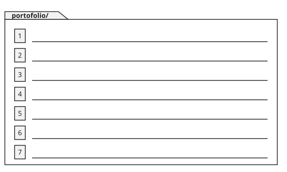

**Ingat dulu:** Tanpa melihat modul:

1. Sebut apa yang kamu cantumkan untuk bahan orang lain dan tiga hal yang tidak boleh ada di karya yang dibagikan. ______
2. Sebut tiga bagian penjelasan satu menit tentang produkmu. ______

`[Gambar: sebuah folder bernama portofolio dengan tujuh baris berkas di dalamnya, masing-masing berupa garis kosong untuk menulis nama berkas yang jelas.]`

**Prediksi:** Dua folder portofolio rekaan:

- **Folder X.** Empat puluh berkas bernama `baru1`, `baru2`, dan seterusnya; di dalamnya ada foto teman sekelas dan catatan berisi kata sandi.
- **Folder Y.** Tujuh berkas bernama jelas: rancangan, kode versi akhir, catatan uji, catatan penyebab, laporan, aturan pakai AI kelas, dan refleksi.

Folder mana yang masih berguna enam bulan lagi untuk menjelaskan apa yang kamu pelajari? ______ Folder mana yang melanggar aturan? ______

Satu alasan untuk tiap folder: X ______ Y ______

**Lengkapi:** Refleksi tiga kalimat untuk produk timmu. Isi tabel.

| Bagian | Isi timmu |
| --- | --- |
| Yang berhasil | |
| Yang berubah karena uji | |
| Yang akan kulatih lagi | |

**Latihan:**

1. Tulis ulang Folder X menjadi folder yang mengikuti aturan portofolio. ______
2. Isi tujuh baris berkas portofolio untuk produk timmu pada gambar, dengan nama berkas yang jelas.
3. Jelaskan dengan kata sendiri mengapa catatan uji dan catatan penyebab menunjukkan proses belajar. ______

**Cek diri:**

- [ ] Setiap berkas punya nama yang jelas.
- [ ] Tidak ada nama asli, foto teman, nama sekolah, atau kata sandi.
- [ ] Aku menulis refleksi dulu dari ingatan.

**Catatan cetak (untuk guru, tidak dicetak):** satu lembar A4, satu sampai dua halaman. Kunci ada di modul `SMP9-2-M13`, bagian "Contoh terselesaikan", "Catatan untuk guru" (kunci), dan "Cek mandiri". Bagian "Susun" dilewati karena minggu portofolio memakai rencana berkas, bukan satu program berurutan. Lembar tidak memuat kolom nama, kelas, tanggal, atau nilai.
