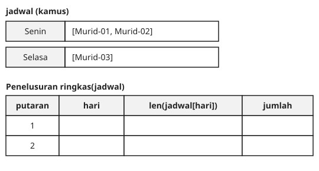

**Ingat dulu:** Tanpa catatan dan tanpa melihat modul:

1. Tulis fungsi yang mencari nilai di kamus dan memberi daftar kosong bila kuncinya tidak ada. ______
2. Tulis fungsi yang membuang spasi di ujung dan menyeragamkan huruf besar. ______
3. Sebut tiga hal yang kamu cari saat membaca kode bahasa lain. ______



`[Gambar: kamus jadwal berisi Senin dengan Murid-01 dan Murid-02, dan Selasa dengan Murid-03. Di bawahnya tabel penelusuran ringkas(jadwal) dengan kolom putaran, hari, len(jadwal[hari]), dan jumlah; dua baris putaran kosong.]`

**Prediksi:** Tulis prediksimu sebelum menelusuri. Program X:

```python
def rapikan(teks):
    return teks.strip().capitalize()


def cari_petugas(jadwal, hari):
    return jadwal.get(rapikan(hari), [])


def ringkas(jadwal):
    if len(jadwal) == 0:
        return "jadwal kosong"
    jumlah = 0
    for hari in jadwal:
        jumlah = jumlah + len(jadwal[hari])
    return str(jumlah) + " petugas dalam " + str(len(jadwal)) + " hari"


jadwal = {"Senin": ["Murid-01", "Murid-02"], "Selasa": ["Murid-03"]}
print(cari_petugas(jadwal, "  SENIN "))
print(cari_petugas(jadwal, "kamis"))
print(ringkas(jadwal))
print(ringkas({}))
print(ringkas({"Rabu": []}))
```

Yang tercetak pada kelima baris: ______ / ______ / ______ / ______ / ______

Telusuri `rapikan` dan `jumlah` per putaran, dan isi tabel pada gambar.

**Lengkapi:** Fungsi yang memberi banyak petugas pada satu hari, memakai `rapikan` di atas. Untuk `"  SENIN "` hasilnya 2 dan untuk `"kamis"` hasilnya 0.

```python setengah-jadi
def jumlah_petugas(jadwal, hari):
    return len(jadwal.get(____, ____))
```

**Latihan:** Kerjakan tanpa catatan dan tanpa AI.

1. Fungsi `jumlah_petugas(jadwal, hari)` ditulis `return len(jadwal[hari])`. Tulis jenis galat untuk hari `"Kamis"` yang tidak ada, penyebabnya, dan perbaikannya. ______
2. Tulis tiga kasus uji untuk `rapikan` dan hasil diharapkan masing-masing, termasuk satu masukan kosong. ______
3. Jelaskan dengan kata sendiri mengapa fungsi ringkasan data perlu pengaman data kosong. ______

**Cek diri:**

- [ ] Aku menjawab sebelum melihat kunci.
- [ ] Aku menandai soal yang salah dan menyebut sebabnya.
- [ ] Aku menulis satu hal yang akan kulatih ulang.

**Catatan cetak (untuk guru, tidak dicetak):** satu lembar A4, satu sampai dua halaman. Kunci ada di modul `SMP9-2-M14`, bagian "Contoh terselesaikan", "Catatan untuk guru" (kunci), dan "Cek mandiri". Bagian "Susun" dilewati karena minggu ini berisi kuis mengingat, bukan penyusunan program. Lembar tidak memuat kolom nama, kelas, tanggal, atau nilai.
