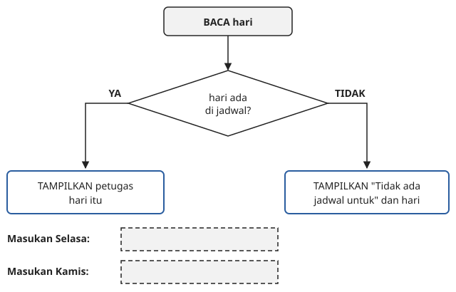

**Ingat dulu:** Tanpa melihat modul:

1. Tulis rancangan solusi untuk satu persoalan sekitar: tujuan, masukan, proses, dan keluaran. ______
2. Tulis dari ingatan kondisi JIKA ... MAKA ... LAINNYA dan telusuri dua masukan. ______



`[Gambar: diagram alir dari atas ke bawah. Kotak BACA hari, lalu belah ketupat "hari ada di jadwal?". Cabang YA ke kotak TAMPILKAN petugas hari itu; cabang TIDAK ke kotak TAMPILKAN "Tidak ada jadwal untuk" dan hari. Di sisi kanan dua kotak kosong berlabel Masukan Selasa dan Masukan Kamis untuk menulis apa yang tampil.]`

**Prediksi:** Jadwal rekaan: Senin dikerjakan Murid-01 dan Murid-02, Selasa Murid-03, Rabu Murid-04 dan Murid-05. Proses dalam pseudocode:

```text
BACA hari
JIKA hari ada di jadwal MAKA
    TAMPILKAN petugas hari itu
LAINNYA
    TAMPILKAN "Tidak ada jadwal untuk" dan hari
```

Yang tampil untuk masukan `Selasa`: ______ Untuk masukan `Kamis`: ______

Telusuri satu baris demi satu baris dan isi dua kotak pada gambar.

**Lengkapi:** Rancangan untuk persoalan pilihan timmu. Isi tabel.

| Bagian rancangan | Isi timmu |
| --- | --- |
| Tujuan satu kalimat | |
| Masukan | |
| Proses | |
| Keluaran | |
| Data rekaan | |
| Bagian kecil (tiga) | |
| Kasus uji awal (tiga) | |

**Latihan:**

1. Telusuri pseudocode jadwal piket untuk masukan `Senin` dan `Jumat`; tulis hasil tiap baris. ______
2. Rancangan "program yang membantu piket supaya semua senang" tidak punya masukan dan keluaran yang jelas. Tulis ulang menjadi rancangan dengan tujuan, masukan, proses, dan keluaran. ______
3. Jelaskan rancanganmu lisan dalam satu menit, dari masukan sampai keluaran, lalu tulis satu hal yang kurang jelas. ______

**Cek diri:**

- [ ] Rancangan timku punya tujuan, masukan, proses, dan keluaran.
- [ ] Prosesnya sudah kutelusuri dengan dua masukan.
- [ ] Rancangan timku punya tiga kasus uji awal.

**Catatan cetak (untuk guru, tidak dicetak):** satu lembar A4, satu sampai dua halaman. Kunci ada di modul `SMP9-2-M2`, bagian "Contoh terselesaikan", "Catatan untuk guru" (kunci), dan "Cek mandiri". Bagian "Susun" dilewati karena modul tidak memuat soal urutan. Lembar tidak memuat kolom nama, kelas, tanggal, atau nilai.
