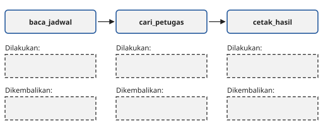

**Ingat dulu:** Tanpa melihat modul:

1. Tulis kerangka program dengan tiga fungsi: membaca, memproses, dan mencetak. ______
2. Jelaskan beda `print` dan `return` di dalam fungsi. ______



`[Gambar: tiga kotak berurutan dari kiri ke kanan dengan panah: baca_jadwal, cari_petugas, dan cetak_hasil. Di bawah tiap kotak dua kotak isian kosong: Dilakukan dan Dikembalikan.]`

**Prediksi:** Rancangan piket menjadi kerangka berikut. Fungsi `cari_petugas` masih berisi **isi sementara**: ia selalu memberi `["Murid-01"]`, apa pun harinya.

```python
def baca_jadwal():
    return {"Senin": ["Murid-01", "Murid-02"]}


def cari_petugas(jadwal, hari):
    return ["Murid-01"]


def cetak_hasil(hari, petugas):
    print("Piket", hari + ":", ", ".join(petugas))


jadwal = baca_jadwal()
cetak_hasil("Rabu", cari_petugas(jadwal, "Rabu"))
```

Yang tercetak: ______ Apakah hasilnya sudah benar menurut rancangan? ______

Telusuri pemanggilannya dan isi garis pada gambar untuk tiap fungsi.

**Lengkapi:** Kerangka timmu sendiri, dengan isi sementara (contoh memakai jadwal piket).

```python setengah-jadi
def baca_jadwal():
    return ____


def cari_petugas(jadwal, hari):
    return ____  # TODO: isi sementara


def cetak_hasil(hari, petugas):
    print(____)


jadwal = baca_jadwal()
cetak_hasil("Senin", cari_petugas(jadwal, "Senin"))
```

**Latihan:**

1. Salin kerangka di atas, jalankan, lalu ubah hari menjadi `Senin`. Yang tercetak: ______
2. Ubah `cetak_hasil` agar lebih dulu mencetak `Hari:` dan nama hari di satu baris sendiri. ______
3. Jelaskan dengan kata sendiri mengapa kerangka dijalankan sebelum bagian lain lengkap. ______

**Cek diri:**

- [ ] Kerangka timku punya tiga fungsi dan satu pemanggil.
- [ ] Kerangka timku sudah dijalankan sampai ujung.
- [ ] Tiap isi sementara kutandai dengan `TODO`.

**Catatan cetak (untuk guru, tidak dicetak):** satu lembar A4, satu sampai dua halaman. Kunci ada di modul `SMP9-2-M3`, bagian "Contoh terselesaikan", "Catatan untuk guru" (kunci), dan "Cek mandiri". Bagian "Susun" dilewati karena modul tidak memuat soal urutan. Lembar tidak memuat kolom nama, kelas, tanggal, atau nilai.
