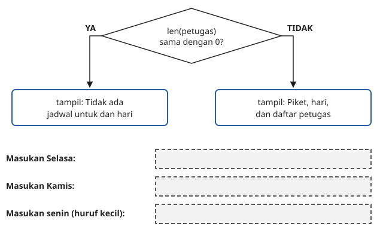

**Ingat dulu:** Tanpa melihat modul:

1. Sebut tugas tiga fungsi kerangka dan apa yang dikembalikan masing-masing. ______
2. Jelaskan beda `kamus.get(k)` dan `kamus[k]` untuk kunci yang tidak ada. ______



`[Gambar: diagram alir cetak_hasil. Belah ketupat "len(petugas) sama dengan 0?". Cabang YA ke kotak: tampil Tidak ada jadwal untuk dan hari. Cabang TIDAK ke kotak: tampil Piket, hari, dan petugas. Di bawah tiga baris isian kosong: masukan Selasa, masukan Kamis, masukan senin (huruf kecil).]`

**Prediksi:** Jadwal rekaan memuat tiga hari, dan `cari_petugas` memakai `get` dengan daftar kosong sebagai nilai cadangan.

```python
def baca_jadwal():
    return {
        "Senin": ["Murid-01", "Murid-02"],
        "Selasa": ["Murid-03"],
        "Rabu": ["Murid-04", "Murid-05"],
    }


def cari_petugas(jadwal, hari):
    return jadwal.get(hari, [])


def cetak_hasil(hari, petugas):
    if len(petugas) == 0:
        print("Tidak ada jadwal untuk", hari)
    else:
        print("Piket", hari + ":", ", ".join(petugas))


jadwal = baca_jadwal()
hari = input("Hari? ")
cetak_hasil(hari, cari_petugas(jadwal, hari))
```

Yang tercetak bila pengguna mengetik `Selasa`, `Kamis`, dan `senin`: tulis pada tiga baris isian di gambar, lalu telusuri.

**Lengkapi:** Lengkapi dua fungsi di bawah untuk produk timmu (contoh memakai jadwal piket).

```python setengah-jadi
def cari_petugas(jadwal, hari):
    return jadwal.get(____, ____)


def cetak_hasil(hari, petugas):
    if len(petugas) == ____:
        print("Tidak ada jadwal untuk", hari)
    else:
        print("Piket", hari + ":", ", ".join(petugas))
```

**Latihan:**

1. Jalankan produkmu dengan masukan `Rabu`. Yang tercetak: ______
2. Tambahkan hari `Kamis` dengan dua petugas samaran ke jadwal, lalu jalankan dengan masukan `Kamis`. Yang tercetak: ______
3. Jelaskan dengan kata sendiri mengapa `get(hari, [])` lebih aman daripada `jadwal[hari]` di produk ini. ______

**Cek diri:**

- [ ] Produk timku berjalan untuk tiga kasus uji awal.
- [ ] Hasil tiap kasus kucatat.
- [ ] Jadwal produk hanya memuat nama samaran.

**Catatan cetak (untuk guru, tidak dicetak):** satu lembar A4, satu sampai dua halaman. Kunci ada di modul `SMP9-2-M4`, bagian "Contoh terselesaikan", "Catatan untuk guru" (kunci), dan "Cek mandiri". Bagian "Susun" dilewati karena modul tidak memuat soal urutan. Lembar tidak memuat kolom nama, kelas, tanggal, atau nilai.
