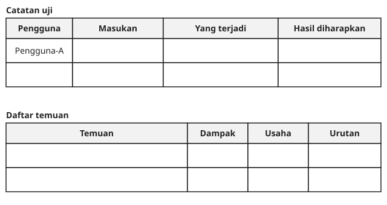

**Ingat dulu:** Tanpa melihat modul:

1. Tulis tiga kasus uji dan satu pertanyaan yang kamu ajukan kepada pengguna yang menguji produkmu. ______
2. Sebut bagian satu kasus uji: masukan, hasil diharapkan, dan hasil sebenarnya. ______

`[Gambar: dua tabel kosong. Tabel atas: Catatan uji dengan kolom Pengguna (terisi Pengguna-A), Masukan, Yang terjadi, dan Hasil diharapkan. Tabel bawah: Daftar temuan dengan kolom Temuan, Dampak, Usaha, dan Urutan, dua baris kosong.]`

**Prediksi:** Dua catatan rekaan dari sesi uji produk piket:

- **Catatan X.** "Pengguna-A bingung. Produknya mungkin kurang bagus."
- **Catatan Y.** "Pengguna-A mengetik `senin`. Layar menampilkan `Tidak ada jadwal untuk senin`. Ia diam sekitar sepuluh detik, lalu mengetik `Senin`."

Catatan mana yang lebih berguna untuk memperbaiki produk? ______

Satu alasan untuk tiap catatan: X ______ Y ______

**Lengkapi:** Isi tabel pada gambar untuk produk timmu, dengan satu pengguna yang dipilih bersama gurumu; tanpa nama. Isi juga daftar temuan beserta dampak, usaha, dan urutannya.

**Latihan:**

1. Tulis ulang "pengguna kesal karena hasilnya lambat" menjadi catatan yang hanya berisi apa yang terjadi. ______
2. Ganti pertanyaan "Bagus, kan?" menjadi pertanyaan terbuka. ______
3. Jelaskan mengapa pengamat tidak boleh membantu pengguna di tengah sesi. ______

**Cek diri:**

- [ ] Catatan ujiku memisahkan kejadian dari tafsiran.
- [ ] Aku tidak mencatat nama, foto, atau suara pengguna.
- [ ] Daftar perbaikanku punya urutan dan satu yang ditunda dengan alasan.

**Catatan cetak (untuk guru, tidak dicetak):** satu lembar A4, satu sampai dua halaman. Kunci ada di modul `SMP9-2-M5`, bagian "Contoh terselesaikan", "Catatan untuk guru" (kunci), dan "Cek mandiri". Bagian "Susun" dilewati karena modul tidak memuat soal urutan. Lembar tidak memuat kolom nama, kelas, tanggal, atau nilai.
