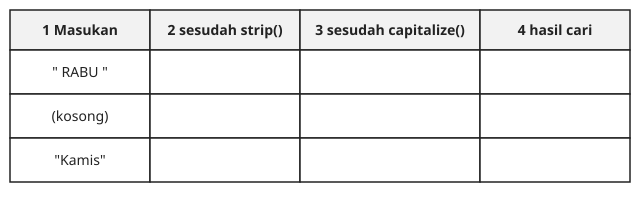

**Ingat dulu:** Tanpa melihat modul:

1. Tulis satu catatan penyebab: gejala, penyebab, perbaikan, aturan umum. ______
2. Jelaskan beda `jadwal.get(hari, [])` dan `jadwal[hari]` untuk hari yang tidak ada. ______



`[Gambar: tabel alur dengan empat kolom: 1 Masukan, 2 sesudah strip(), 3 sesudah capitalize(), dan 4 hasil cari. Tiga baris masukan: "  RABU " (dengan spasi di ujung), kosong, dan Kamis. Kolom 2 sampai 4 masih kosong.]`

**Prediksi:** Daftar perbaikan sudah dikerjakan: masukan dirapikan dengan fungsi `rapikan`, dan masukan kosong mendapat pesan sendiri.

```python
def baca_jadwal():
    return {
        "Senin": ["Murid-01", "Murid-02"],
        "Selasa": ["Murid-03"],
        "Rabu": ["Murid-04", "Murid-05"],
    }


def rapikan(teks):
    return teks.strip().capitalize()


def cari_petugas(jadwal, hari):
    return jadwal.get(rapikan(hari), [])


def cetak_hasil(hari, petugas):
    if rapikan(hari) == "":
        print("Hari belum diisi")
    elif len(petugas) == 0:
        print("Tidak ada jadwal untuk", rapikan(hari))
    else:
        print("Piket", rapikan(hari) + ":", ", ".join(petugas))


jadwal = baca_jadwal()
hari = input("Hari? ")
cetak_hasil(hari, cari_petugas(jadwal, hari))
```

`strip()` membuang spasi di ujung teks; `capitalize()` membuat huruf pertama besar dan sisanya kecil.

Yang tercetak untuk masukan `  RABU `: ______ Untuk masukan kosong: ______ Untuk `Kamis`: ______

Telusuri `rapikan(hari)` pada tiap masukan dan isi gambar.

**Lengkapi:** Tulis `rapikan` untuk produk timmu, lalu isi catatan penyebab untuk satu temuan dari daftar perbaikanmu.

```python setengah-jadi
def rapikan(teks):
    return teks.____().____()
```

| Bagian | Isi timmu |
| --- | --- |
| Gejala | |
| Penyebab | |
| Perbaikan | |
| Aturan umum | |

**Latihan:**

1. Jalankan produk dengan masukan `kamis` dan `  SENIN `. Yang tercetak untuk masing-masing: ______ / ______
2. Tambahkan hari `Kamis` dengan satu petugas samaran, lalu jalankan lagi dengan masukan `kamis`. Yang tercetak: ______
3. Sebut satu temuan yang sengaja kamu tunda dan alasannya. ______

**Cek diri:**

- [ ] Tiap perbaikan timku punya catatan penyebab.
- [ ] Semua kasus uji kujalankan ulang sesudah perbaikan.
- [ ] Aku menulis satu temuan yang kutunda beserta alasannya.

**Catatan cetak (untuk guru, tidak dicetak):** satu lembar A4, satu sampai dua halaman. Kunci ada di modul `SMP9-2-M6`, bagian "Contoh terselesaikan", "Catatan untuk guru" (kunci), dan "Cek mandiri". Bagian "Susun" dilewati karena modul tidak memuat soal urutan. Lembar tidak memuat kolom nama, kelas, tanggal, atau nilai.
