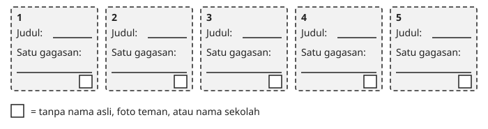

**Ingat dulu:** Tanpa melihat modul:

1. Tulis dari ingatan rancangan solusi: tujuan, masukan, proses, keluaran. ______
2. Sebut dua cara sebuah grafik bisa menyesatkan pembacanya. ______

`[Gambar: lima bingkai slide kosong berurutan bernomor 1 sampai 5. Tiap bingkai punya garis Judul, garis Satu gagasan, dan satu kotak centang kecil di sudut bawah. Keterangan di bawah gambar: kotak centang berarti tanpa nama asli, foto teman, atau nama sekolah.]`

**Prediksi:** Dua rencana rekaan untuk slide yang menjelaskan hasil uji produk piket:

- **Slide X.** Dua belas baris teks kecil, enam warna, dan foto teman sekelas sedang menguji produk.
- **Slide Y.** Satu judul, satu kalimat, dan satu tabel kecil berisi masukan, hasil sebelum, dan hasil sesudah perbaikan.

Slide mana yang lebih mudah diikuti dalam lima menit presentasi? ______ Slide mana yang melanggar aturan berbagi karya? ______

Satu alasan untuk tiap slide: X ______ Y ______

**Lengkapi:** Rencana laporan untuk produk timmu. Isi tabel.

| Bagian | Isi timmu |
| --- | --- |
| 1. Persoalan dan pengguna | |
| 2. Rancangan | |
| 3. Produk | |
| 4. Pengujian | |
| 5. Perbaikan | |
| 6. Yang ditunda dan batas | |
| 7. Bahan orang lain dan data | |

**Latihan:**

1. Tulis ulang Slide X menjadi slide yang mengikuti aturan berbagi karya dan aturan satu slide. ______
2. Buat lima slide dari rencanamu dengan satu gagasan per slide, pada bingkai di gambar. Periksa bahwa tidak ada nama asli, foto teman, atau nama sekolah.
3. Presentasikan lima slidemu dalam lima menit dan minta satu tim lain menyebut apa yang kurang jelas. ______

**Cek diri:**

- [ ] Laporan timku punya tujuh bagian.
- [ ] Setiap slide hanya memuat satu gagasan.
- [ ] Tidak ada nama asli, foto teman, atau nama sekolah di laporan dan slide.

**Catatan cetak (untuk guru, tidak dicetak):** satu lembar A4, satu sampai dua halaman. Kunci ada di modul `SMP9-2-M7`, bagian "Contoh terselesaikan", "Catatan untuk guru" (kunci), dan "Cek mandiri". Bagian "Susun" dilewati karena modul tidak memuat soal urutan. Lembar tidak memuat kolom nama, kelas, tanggal, atau nilai.
