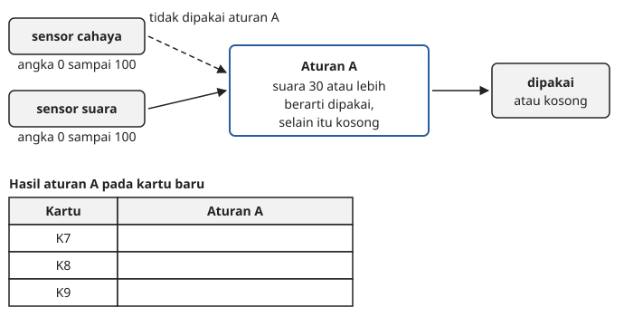

**Ingat dulu:** Tanpa melihat modul:

1. Sebut dua sensor dan apa yang diukur masing-masing. ______
2. Gambar diagram masukan, proses, dan keluaran untuk satu perangkat. ______

`[Gambar: diagram blok dari kiri ke kanan. Dua kotak masukan: sensor cahaya dan sensor suara (angka 0 sampai 100); panah dari sensor cahaya putus-putus dan bertuliskan tidak dipakai aturan A. Panah dari sensor suara ke kotak proses "Aturan A: suara 30 atau lebih berarti dipakai, selain itu kosong", lalu panah ke kotak keluaran "dipakai atau kosong". Di bawahnya tabel kosong untuk kartu K7, K8, dan K9.]`

**Prediksi:** Sebuah alat rekaan menandai ruang kelas piket sebagai **dipakai** atau **kosong**. Enam kartu bacaan rekaan, dengan keadaan sebenarnya:

| Kartu | Cahaya | Suara | Sebenarnya |
| --- | --- | --- | --- |
| K1 | 80 | 55 | dipakai |
| K2 | 10 | 5 | kosong |
| K3 | 85 | 10 | dipakai (ujian, semua diam) |
| K4 | 0 | 45 | kosong (suara dari lorong) |
| K5 | 70 | 8 | kosong (lampu lupa dimatikan) |
| K6 | 60 | 30 | dipakai |

Aturan A: "bila suara 30 atau lebih, tandai dipakai; selain itu kosong". Tebakanku: kartu yang ditandai salah oleh aturan A adalah ______

**Lengkapi:** Terapkan aturan A pada tiga kartu baru, lalu tulis hasilnya pada gambar.

| Kartu | Cahaya | Suara | Aturan A |
| --- | --- | --- | --- |
| K7 | 20 | 35 | |
| K8 | 90 | 3 | |
| K9 | 5 | 30 | |

**Susun:** Empat kartu langkah untuk satu kartu bacaan berikut diacak: (A) tulis label di bawah kartu; (B) baca angka suara; (C) bandingkan angka dengan 30; (D) ambil satu kartu bacaan.

Urutanku di mejaku: ______ , ______ , ______ , ______

**Latihan:**

1. Terapkan aturan A pada K1 sampai K6 di kertasmu tanpa melihat tabel. Berapa kartu yang benar? ______
2. Ganti batas 30 menjadi 50. Kartu mana yang labelnya berubah? ______ Berapa kartu yang benar sekarang? ______
3. Jelaskan dengan kata sendiri mengapa angka dari sensor belum berarti "ada orang". ______

**Cek diri:**

- [ ] Aku menerapkan aturan pada kartu satu per satu.
- [ ] Aku menghitung berapa kartu yang benar.
- [ ] Aku menyebut satu kartu yang salah beserta sebabnya.

**Catatan cetak (untuk guru, tidak dicetak):** satu lembar A4, satu sampai dua halaman. Kunci ada di modul `SMP9-2-M8`, bagian "Contoh terselesaikan", "Catatan untuk guru" (kunci), dan "Cek mandiri". Lembar tidak memuat kolom nama, kelas, tanggal, atau nilai.
