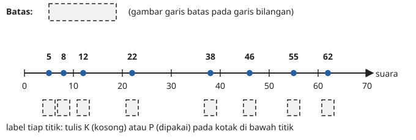

**Ingat dulu:** Tanpa melihat modul:

1. Jelaskan mengapa sensor memberi angka dan bukan "ada orang", dan beri satu cara mengurangi salah baca. ______
2. Jelaskan mengapa 60 lemparan tidak cukup untuk menilai dadu adil sedangkan 6000 lebih meyakinkan. ______

`[Gambar: garis bilangan suara dari 0 sampai 70. Delapan titik kartu latih di suara 5, 8, 12, 22, 38, 46, 55, dan 62. Di bawah tiap titik satu kotak kosong untuk menulis label: K untuk kosong, P untuk dipakai. Di atas ada kotak kosong berlabel Batas.]`

**Prediksi:** Batas dicari dari contoh. Delapan **kartu latih** rekaan, masing-masing berisi angka suara dan label dari manusia:

| Suara | 5 | 8 | 12 | 22 | 38 | 46 | 55 | 62 |
| --- | --- | --- | --- | --- | --- | --- | --- | --- |
| Label | kosong | kosong | kosong | kosong | dipakai | dipakai | dipakai | dipakai |

Kamu mencari satu batas "suara sama atau lebih dari batas berarti dipakai". Batas berapa yang benar pada semua delapan kartu latih? Gambar pada garis bilangan. ______

Menurutmu, apakah batas itu akan benar juga pada kartu yang belum pernah dilihat? ______

**Lengkapi:** Kartu latih rekaan: suara 7 kosong, 18 kosong, 36 dipakai, 50 dipakai. Latih model, lalu uji tiga kartu uji. Isi tabel.

| Hal | Isi |
| --- | --- |
| Kosong paling keras | |
| Dipakai paling pelan | |
| Batas (titik tengah) | |
| Kartu uji 20, 29, 41 (hasil model) | |

**Susun:** Empat kartu langkah melatih model berikut diacak: (A) tulis batas sebagai aturan; (B) uji dengan kartu yang belum pernah dilihat; (C) cari batas di antara label yang berbeda; (D) urutkan kartu latih dari suara terkecil.

Urutanku: ______ , ______ , ______ , ______

**Latihan:** Enam kartu uji rekaan yang belum pernah dilihat model:

| Suara | Sebenarnya | Model (batas 30) | Benar? |
| --- | --- | --- | --- |
| 10 | kosong | | |
| 33 | dipakai | | |
| 28 | dipakai (berbisik) | | |
| 48 | kosong (suara lorong) | | |
| 70 | dipakai | | |
| 3 | kosong | | |

1. Terapkan batas 30 pada enam kartu uji lalu hitung yang benar. ______
2. Pakai batas 42. Kartu mana yang berubah hasilnya dari batas 30? ______
3. Jelaskan dengan kata sendiri mengapa kartu latih saja tidak cukup untuk menilai model. ______

**Cek diri:**

- [ ] Aku memilih batas dari kartu latih saja.
- [ ] Aku menguji model pada kartu yang belum pernah dilihat.
- [ ] Aku menyebut satu cara data bisa rusak.

**Catatan cetak (untuk guru, tidak dicetak):** satu lembar A4, satu sampai dua halaman. Kunci ada di modul `SMP9-2-M9`, bagian "Contoh terselesaikan", "Catatan untuk guru" (kunci), dan "Cek mandiri". Lembar tidak memuat kolom nama, kelas, tanggal, atau nilai.
