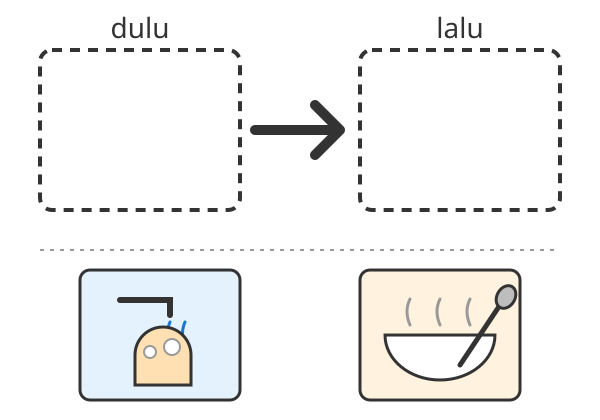

`[Gambar: dua kotak besar berdampingan di tengah kertas. Di antara keduanya ada panah ke kanan yang tebal. Di atas kotak kiri tertulis "dulu"; di atas kotak kanan tertulis "lalu". Kedua kotak masih kosong.]`

`[Gambar: di bagian bawah kertas ada dua kartu kecil untuk digunting dan ditempel. Kartu pertama bergambar tangan di bawah keran air dengan busa sabun. Kartu kedua bergambar mangkuk dan sendok yang mengepul. Gambar kartu sederhana, tanpa wajah.]`

**Kata guru:** "Lihat dua kartu ini. Mana yang lebih dulu? Tempel di kotak 'dulu'. Lalu tempel yang satunya di kotak 'lalu'."

**Kotak jawab:** tempel dua kartu di dua kotak besar.

**Ceritakan:** `[Gambar: satu kotak kosong di bawah kotak jawab, dengan gambar kecil mulut yang sedang berbicara.]`

**Kata guru:** "Ceritakan ke temanmu atau ke Bu atau Pak Guru: dulu apa, lalu apa?"

**Catatan cetak (untuk guru, tidak dicetak):** cetak satu lembar tiap kelompok kecil (3 sampai 4 anak), kertas ukuran A4. Gunting dua kartu sebelum kegiatan. Lembar tidak memuat kolom nama, tanggal, atau penilaian; tanda kertas milik kelompok diurus guru di sekolah.
