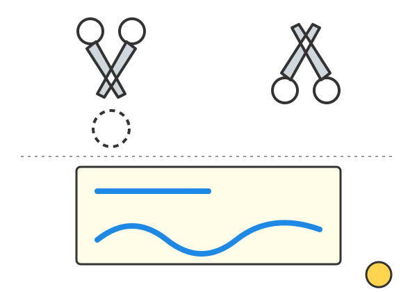

# Memakai alat dengan aman

`[Gambar: dua gunting berdampingan. Gunting kiri dipegang dengan ujungnya menghadap ke bawah. Gunting kanan dipegang dengan ujungnya menghadap ke atas. Di bawah gunting kiri ada lingkaran putus-putus untuk stiker. Di bawahnya ada selembar kertas dengan satu garis lurus dan satu garis melengkung berwarna tebal.]`

`[Gambar: di bagian bawah ada satu stiker bulat kuning untuk digunting.]`

**Kata guru:** "Lihat dua gunting ini. Ujungnya berbeda. Tempel stiker di gunting yang ujungnya ke bawah. Ingat aturannya: duduk, ujung ke bawah."

**Kotak jawab:** tempel stiker di lingkaran putus-putus di bawah gunting kiri.

**Ceritakan:** `[Gambar: satu kotak kosong di bawah, dengan gambar kecil mulut yang sedang berbicara.]`

**Kata guru:** "Ceritakan: apa aturan aman memakai gunting?"

**Catatan cetak (untuk guru, tidak dicetak):** satu lembar per anak, kertas A4. Kertas berpola dipotong hanya dengan gunting anak dan pengawasan penuh. Gunting stiker sebelum kegiatan. Tanpa kolom nama, tanggal, atau penilaian.
