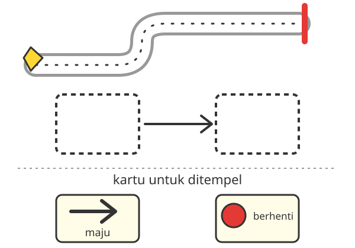

`[Gambar: satu jalur berkelok dari titik awal (bintang) di kiri ke garis melintang berwarna merah di kanan. Di bawah jalur ada dua kotak kosong bergaris putus-putus, kotak pertama dan kotak kedua, dihubungkan tanda panah.]`

`[Gambar: di bagian bawah ada dua kartu untuk digunting: satu kartu bergambar panah tebal ke depan dengan tulisan "maju", satu kartu bergambar lingkaran merah dengan tulisan "berhenti". Gunting satu salinan tiap kartu.]`

**Kata guru:** "Robot mulai dari bintang. Robot harus maju lebih dulu, lalu berhenti di garis merah. Tempel kartu di kotak pertama dan kotak kedua."

**Kotak jawab:** tempel kartu di dua kotak, kartu pertama di kotak pertama, kartu kedua di kotak kedua.

**Ceritakan:** `[Gambar: satu kotak kosong di bawah, dengan gambar kecil mulut yang sedang berbicara.]`

**Kata guru:** "Ceritakan: apa perintah pertama, dan apa perintah sesudahnya?"

**Catatan cetak (untuk guru, tidak dicetak):** satu lembar per kelompok kecil (3 sampai 4 anak), kertas A4; siapkan dua kartu per lembar. Tanpa kolom nama, tanggal, atau penilaian.
