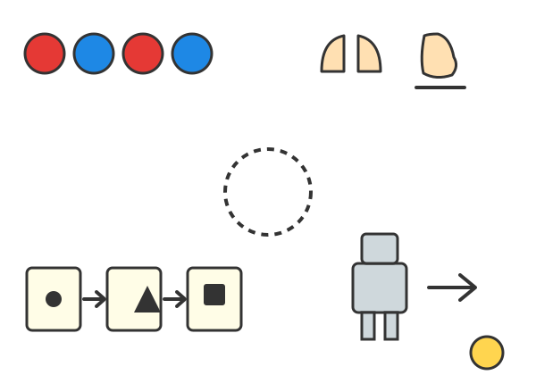

# Pameran kecil dan cerita

`[Gambar: empat gambar permainan di empat sudut kertas. Kiri atas: satu baris lingkaran merah dan biru berselang-seling. Kanan atas: dua tangan bertepuk dan telapak kaki. Kiri bawah: tiga kartu urutan dengan panah di antaranya. Kanan bawah: robot dari kotak dan panah maju. Di tengah ada lingkaran putus-putus.]`

`[Gambar: di bagian bawah ada satu stiker bulat kuning untuk digunting.]`

**Kata guru:** "Ini permainan kita semester ini. Pilih satu permainan yang paling kamu suka. Tempel stiker di gambarnya."

**Kotak jawab:** tempel stiker di samping permainan yang paling disukai.

**Ceritakan:** `[Gambar: satu kotak kosong di bawah, dengan gambar kecil mulut yang sedang berbicara.]`

**Kata guru:** "Ceritakan ke teman atau guru: apa yang kamu lakukan lebih dulu, lalu apa? Apa yang kamu pelajari?"

**Catatan cetak (untuk guru, tidak dicetak):** satu lembar per anak, kertas A4; satu stiker bulat per anak. Tanpa kolom nama, tanggal, atau penilaian.
