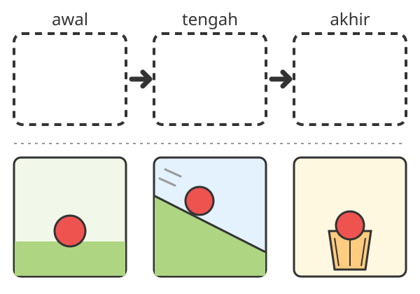

# Cerita tiga gambar

`[Gambar: tiga kotak kosong berjajar di bagian atas kertas, dihubungkan dua panah ke kanan. Di atas kotak pertama tertulis "awal", kotak kedua "tengah", kotak ketiga "akhir".]`

`[Gambar: di bagian bawah ada tiga kartu untuk digunting. Kartu pertama: bola merah di atas rumput. Kartu kedua: bola merah menggelinding menuruni bukit kecil. Kartu ketiga: bola merah di dalam keranjang. Gambar sederhana, tanpa wajah.]`

**Kata guru:** "Tiga kartu ini bercerita tentang bola. Mana yang awal? Tempel di kotak 'awal'. Lalu cari yang tengah, lalu yang akhir."

**Kotak jawab:** tempel tiga kartu di tiga kotak.

**Ceritakan:** `[Gambar: satu kotak kosong di bawah, dengan gambar kecil mulut yang sedang berbicara.]`

**Kata guru:** "Ceritakan dengan katamu sendiri: awalnya apa, lalu apa, akhirnya apa?"

**Catatan cetak (untuk guru, tidak dicetak):** satu lembar per kelompok kecil (3 sampai 4 anak), kertas A4. Gunting tiga kartu sebelum kegiatan dan tumpulkan sudutnya. Tanpa kolom nama, tanggal, atau penilaian; tanda kertas diurus guru di sekolah.
