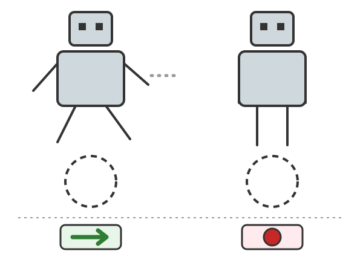

# Aku robot, kamu pemandu

`[Gambar: di bagian atas ada dua robot sederhana dari kotak dan garis, tanpa wajah. Robot kiri melangkah dengan kaki terbuka; robot kanan berdiri tegak dengan kaki rapat. Di bawah tiap robot ada satu lingkaran kosong dengan garis putus-putus.]`

`[Gambar: di bagian bawah ada dua kartu kecil untuk digunting. Kartu pertama: panah hijau ke kanan (artinya "jalan"). Kartu kedua: lingkaran merah (artinya "berhenti").]`

**Kata guru:** "Robot ini sedang jalan, robot ini sedang berhenti. Tempel kartu yang cocok di bawah tiap robot."

**Kotak jawab:** tempel satu kartu di tiap lingkaran.

**Ceritakan:** `[Gambar: satu kotak kosong di bawah, dengan gambar kecil mulut yang sedang berbicara.]`

**Kata guru:** "Ceritakan ke temanmu: kapan robot jalan, kapan robot berhenti?"

**Catatan cetak (untuk guru, tidak dicetak):** satu lembar per kelompok kecil (3 sampai 4 anak), kertas A4. Gunting dua kartu dan tumpulkan sudutnya. Tanpa kolom nama, tanggal, atau penilaian.
