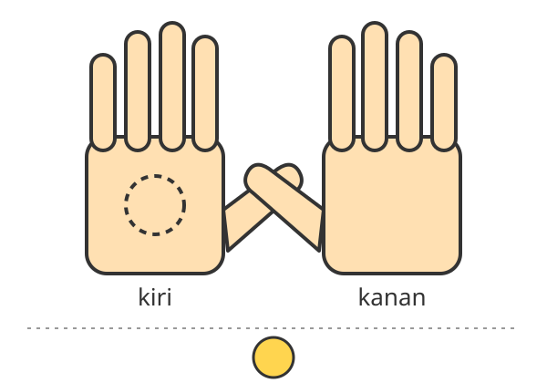

`[Gambar: dua tangan terlihat dari atas, seperti saat anak melihat tangannya sendiri. Tangan di sisi kiri kertas adalah tangan kiri; di punggung tangannya ada lingkaran putus-putus. Tangan di sisi kanan kertas adalah tangan kanan, tanpa lingkaran. Di bawah tangan tertulis "kiri" dan "kanan".]`

`[Gambar: di bagian bawah ada satu stiker bulat kuning untuk digunting.]`

**Kata guru:** "Lihat tanganmu sendiri. Tangan kiri ada di sisi ini. Tempel stiker di tangan kiri di kertas."

**Kotak jawab:** tempel stiker di lingkaran pada tangan kiri.

**Ceritakan:** `[Gambar: satu kotak kosong di bawah, dengan gambar kecil mulut yang sedang berbicara.]`

**Kata guru:** "Tunjukkan tangan kirimu yang sebenarnya. Apa bedanya dengan tangan kanan?"

**Catatan cetak (untuk guru, tidak dicetak):** satu lembar per anak boleh dipakai bersama stiker kertas; kertas A4. Gunting stiker sebelum kegiatan. Tanpa kolom nama, tanggal, atau penilaian.
