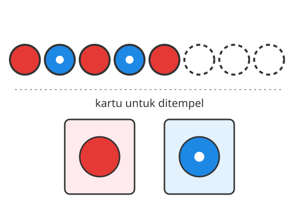

`[Gambar: satu baris lima lingkaran: merah, biru, merah, biru, merah. Lingkaran biru punya titik putih di tengah. Di ujung kanan ada tiga lingkaran kosong dengan garis putus-putus.]`

`[Gambar: di bagian bawah ada dua kartu untuk digunting: satu lingkaran merah dan satu lingkaran biru bertitik. Gunting beberapa salinan agar cukup untuk tiga lingkaran kosong.]`

**Kata guru:** "Lihat barisnya: merah, biru, merah, biru, merah. Apa yang berikutnya? Tempel kartunya di lingkaran kosong."

**Kotak jawab:** tempel kartu di tiga lingkaran kosong.

**Ceritakan:** `[Gambar: satu kotak kosong di bawah, dengan gambar kecil mulut yang sedang berbicara.]`

**Kata guru:** "Ceritakan ke temanmu: sesudah merah, warna apa? Sesudah biru, warna apa?"

**Catatan cetak (untuk guru, tidak dicetak):** satu lembar per kelompok kecil (3 sampai 4 anak), kertas A4; siapkan tiga kartu merah dan tiga kartu biru per lembar. Tanpa kolom nama, tanggal, atau penilaian.
