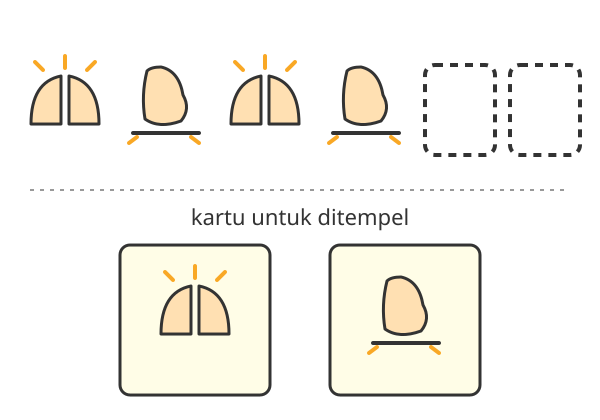

# Pola gerak dan bunyi

`[Gambar: satu baris empat gambar: dua tangan bertepuk, telapak kaki, dua tangan bertepuk, telapak kaki. Di ujung kanan ada dua kotak kosong dengan garis putus-putus.]`

`[Gambar: di bagian bawah ada dua kartu untuk digunting: satu bergambar dua tangan bertepuk, satu bergambar telapak kaki. Gunting beberapa salinan agar cukup untuk dua kotak kosong.]`

**Kata guru:** "Tepuk, hentak, tepuk, hentak. Apa yang berikutnya? Tempel kartunya di kotak kosong, lalu lakukan polanya bersama teman."

**Kotak jawab:** tempel kartu di dua kotak kosong.

**Ceritakan:** `[Gambar: satu kotak kosong di bawah, dengan gambar kecil mulut yang sedang berbicara.]`

**Kata guru:** "Ceritakan polamu: apa dulu, lalu apa?"

**Catatan cetak (untuk guru, tidak dicetak):** satu lembar per kelompok kecil (3 sampai 4 anak), kertas A4; siapkan dua kartu tepuk dan dua kartu hentak per lembar. Tanpa kolom nama, tanggal, atau penilaian.
