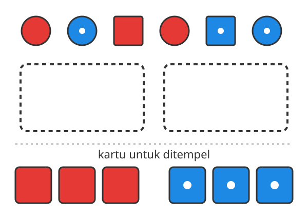

# Kumpulan benda

`[Gambar: di bagian atas ada enam benda bercampur: dua lingkaran merah, dua lingkaran biru bertitik putih, satu persegi merah, dan satu persegi biru bertitik putih. Di bawahnya ada dua kotak besar dengan garis putus-putus, kotak kiri dan kotak kanan.]`

`[Gambar: di bagian bawah ada kartu untuk digunting: enam kartu kecil, tiga merah dan tiga biru bertitik, untuk ditempel di dua kotak.]`

**Kata guru:** "Lihat benda-benda ini. Bagi ke dua kotak dengan satu aturan. Tempelkan kartunya di kotak yang sama aturannya."

**Kotak jawab:** tempel kartu di dua kotak putus-putus, satu kotak untuk satu aturan.

**Ceritakan:** `[Gambar: satu kotak kosong di bawah, dengan gambar kecil mulut yang sedang berbicara.]`

**Kata guru:** "Ceritakan aturanmu: apa yang sama di kotak ini?"

**Catatan cetak (untuk guru, tidak dicetak):** satu lembar per kelompok kecil (3 sampai 4 anak), kertas A4; siapkan enam kartu per lembar. Tanpa kolom nama, tanggal, atau penilaian.
