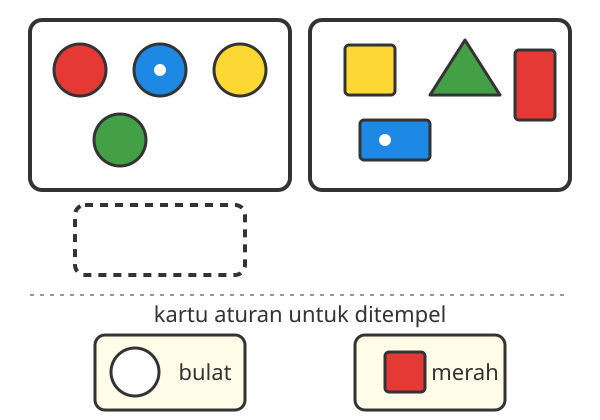

# Tebak aturan

`[Gambar: dua kotak berdampingan. Kotak kiri berisi empat lingkaran, masing-masing berbeda warna: merah, biru bertitik putih, kuning, dan hijau. Kotak kanan berisi satu persegi, satu segitiga, dan dua persegi panjang dengan warna berbeda-beda. Di bawah kotak kiri ada satu kotak kosong putus-putus untuk menempel kartu aturan.]`

`[Gambar: di bagian bawah ada dua kartu aturan untuk digunting: satu kartu bergambar lingkaran dengan tulisan "bulat", satu kartu bergambar sebidang warna merah dengan tulisan "merah".]`

**Kata guru:** "Lihat kotak yang kiri. Coba tebak: kenapa semuanya ada di kotak ini? Tempel kartu aturan yang cocok di bawahnya."

**Kotak jawab:** tempel satu kartu aturan di kotak kosong di bawah kotak kiri.

**Ceritakan:** `[Gambar: satu kotak kosong di bawah, dengan gambar kecil mulut yang sedang berbicara.]`

**Kata guru:** "Ceritakan ke temanmu: apa yang sama di kotak ini? Apa yang berbeda dari kotak yang satunya?"

**Catatan cetak (untuk guru, tidak dicetak):** satu lembar per kelompok kecil (3 sampai 4 anak), kertas A4; siapkan dua kartu aturan per lembar. Tanpa kolom nama, tanggal, atau penilaian.
