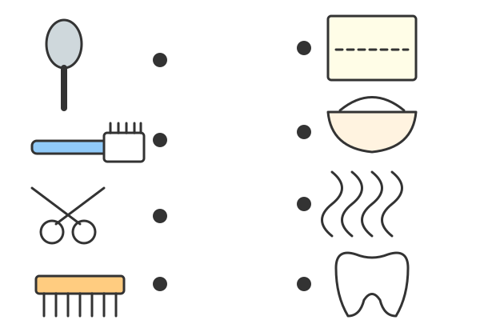

# Alat di sekitar kita

`[Gambar: dua kolom. Kolom kiri berisi empat alat dari atas ke bawah: sendok, sikat gigi, gunting, sisir. Kolom kanan berisi empat gambar kegunaan dengan urutan sengaja diacak: kertas dengan garis putus-putus, mangkuk berisi nasi, helai rambut bergelombang, dan gigi bersih. Di tengah tiap alat dan tiap gambar ada satu titik untuk ujung garis.]`

**Kata guru:** "Ini sendok. Ini sikat. Ini gunting. Ini sisir. Tarik garis dari alat ke gambar kegunaannya."

**Kotak jawab:** tarik garis dari titik alat ke titik gambar kegunaannya.

**Ceritakan:** `[Gambar: satu kotak kosong di bawah, dengan gambar kecil mulut yang sedang berbicara.]`

**Kata guru:** "Pilih satu alat. Ceritakan: alat itu dipakai untuk apa?"

**Catatan cetak (untuk guru, tidak dicetak):** satu lembar per anak, kertas A4; krayon atau pensil warna untuk menarik garis. Tanpa kolom nama, tanggal, atau penilaian.
