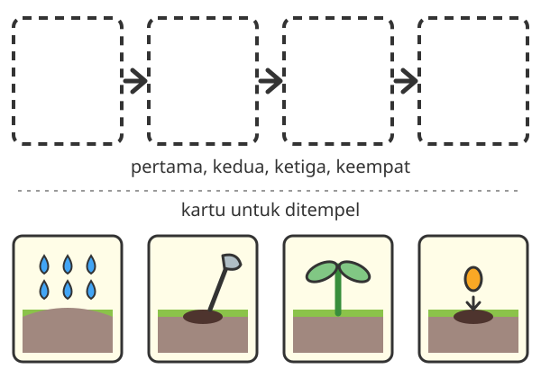

# Urutan empat langkah

`[Gambar: empat kotak kosong bergaris putus-putus berjajar dari kiri ke kanan, dihubungkan tiga tanda panah. Di bawah kotak tertulis "pertama, kedua, ketiga, keempat".]`

`[Gambar: di bagian bawah ada empat kartu untuk digunting, dalam urutan acak: tetesan air di atas tanah, lubang di tanah, tunas hijau tumbuh dari tanah, dan satu biji di atas lubang. Gambar sederhana, tanpa wajah.]`

**Kata guru:** "Empat kartu ini bercerita tentang menanam biji. Mana yang pertama? Tempel di kotak pertama. Lalu cari yang kedua, yang ketiga, dan yang keempat."

**Kotak jawab:** tempel empat kartu di empat kotak, dari kiri ke kanan.

**Ceritakan:** `[Gambar: satu kotak kosong di bawah, dengan gambar kecil mulut yang sedang berbicara.]`

**Kata guru:** "Peragakan dengan tubuhmu: pertama apa, kedua apa, ketiga apa, keempat apa?"

**Catatan cetak (untuk guru, tidak dicetak):** satu lembar per kelompok kecil (3 sampai 4 anak), kertas A4. Gunting empat kartu sebelum kegiatan dan tumpulkan sudutnya. Tanpa kolom nama, tanggal, atau penilaian.
