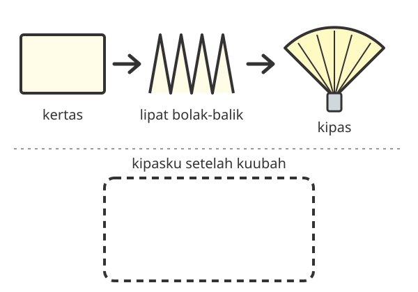

# Merancang kipas

`[Gambar: tiga gambar berurutan dari kiri ke kanan, dihubungkan tanda panah. Pertama: selembar kertas persegi panjang. Kedua: kertas dengan garis lipat bergelombang, depan lalu belakang. Ketiga: kipas terbuka berbentuk setengah lingkaran dengan pangkal dijepit.]`

`[Gambar: di bawah ada satu kotak kosong bergaris putus-putus untuk menggambar kipas setelah diubah.]`

**Kata guru:** "Lipat kertasmu seperti di gambar: depan, belakang, depan, belakang. Coba kipasi tanganmu. Lalu ubah satu hal dan coba lagi."

**Kotak jawab:** gambar kipasmu setelah kamu ubah di kotak kosong.

**Ceritakan:** `[Gambar: satu kotak kosong di bawah, dengan gambar kecil mulut yang sedang berbicara.]`

**Kata guru:** "Kasih tahu temanmu: apa yang kamu ubah? Apa yang berbeda sesudah kamu mengubahnya?"

**Catatan cetak (untuk guru, tidak dicetak):** satu lembar per kelompok kecil, kertas A4; kertas lipat atau karton tipis yang dipotong guru; tepi ditumpulkan. Tanpa kolom nama, tanggal, atau penilaian.
