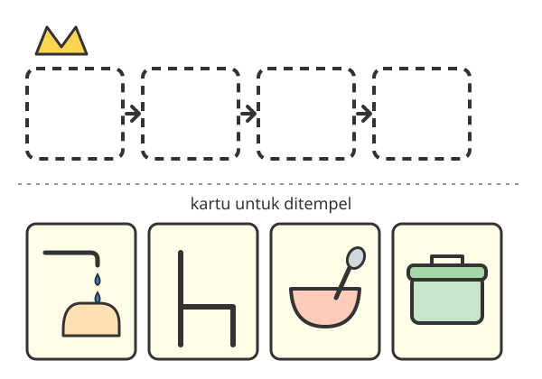

`[Gambar: empat kotak kosong bergaris putus-putus berjajar dari kiri ke kanan, dihubungkan tanda panah. Di atas kotak pertama ada gambar mahkota kecil.]`

`[Gambar: di bagian bawah ada empat kartu untuk digunting: tangan di bawah keran dengan tetes air, kursi, mangkuk dengan sendok, dan kotak bekal tertutup.]`

**Kata guru:** "Ini kegiatan sebelum makan bekal. Susun kartunya di empat kotak. Apa yang pertama? Apa yang terakhir?"

**Kotak jawab:** tempel empat kartu di empat kotak, kartu pertama di kotak pertama.

**Ceritakan:** `[Gambar: satu kotak kosong di bawah, dengan gambar kecil mulut yang sedang berbicara.]`

**Kata guru:** "Kasih tahu temanmu: mana yang lebih dulu, cuci tangan atau makan? Apa yang sesudah makan?"

**Catatan cetak (untuk guru, tidak dicetak):** satu lembar per kelompok kecil, kertas A4; siapkan satu set kartu per lembar. Jawaban contoh untuk guru: cuci tangan, duduk, makan, simpan kotak bekal. Tanpa kolom nama, tanggal, atau penilaian.
