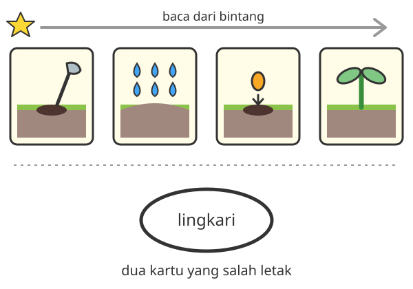

# Eh, ada yang terbalik!

`[Gambar: satu baris empat kartu bergambar dari kiri ke kanan, dengan bintang dan tanda panah baca di atasnya. Urutan kartu: lubang di tanah, tetesan air di atas tanah, biji di atas lubang, tunas hijau. Dua kartu di tengah sengaja tertukar.]`

`[Gambar: di bagian bawah ada lingkaran besar bertuliskan "lingkari" dan teks "dua kartu yang salah letak".]`

**Kata guru:** "Baca dari bintang. Eh, ada yang terbalik! Tunjuk dua kartu yang salah letak, lalu lingkari."

**Kotak jawab:** lingkari dua kartu yang salah letak, lalu tunjukkan urutan yang benar dengan jarimu.

**Ceritakan:** `[Gambar: satu kotak kosong di bawah, dengan gambar kecil mulut yang sedang berbicara.]`

**Kata guru:** "Ceritakan: kartu mana yang seharusnya lebih dulu? Mana yang sesudahnya?"

**Catatan cetak (untuk guru, tidak dicetak):** satu lembar per anak atau per kelompok kecil, kertas A4. Anak melingkari dengan krayon tidak beracun. Tanpa kolom nama, tanggal, atau penilaian.
