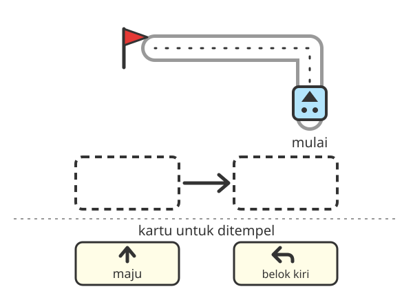

`[Gambar: satu jalur dilihat dari atas. Robot kecil di sisi kanan menghadap ke atas, ditandai "mulai". Jalur lurus ke atas, lalu berbelok ke kiri sampai bendera merah. Di bawahnya dua kotak kosong bergaris putus-putus dengan tanda panah di antaranya.]`

`[Gambar: di bagian bawah ada dua kartu untuk digunting: kartu "maju" dengan panah lurus ke atas, dan kartu "belok kiri" dengan panah melengkung ke kiri. Gunting satu salinan tiap kartu.]`

**Kata guru:** "Robot mulai dari sini dan menghadap ke atas. Robot maju dulu, lalu belok kiri. Tempel kartunya di kotak pertama dan kotak kedua."

**Kotak jawab:** tempel kartu "maju" di kotak pertama dan kartu "belok kiri" di kotak kedua.

**Ceritakan:** `[Gambar: satu kotak kosong di bawah, dengan gambar kecil mulut yang sedang berbicara.]`

**Kata guru:** "Tunjuk tangan kirimu. Apa yang dilakukan robot sesudah maju?"

**Catatan cetak (untuk guru, tidak dicetak):** satu lembar per kelompok kecil, kertas A4; siapkan dua kartu per lembar. Tanpa kolom nama, tanggal, atau penilaian.
