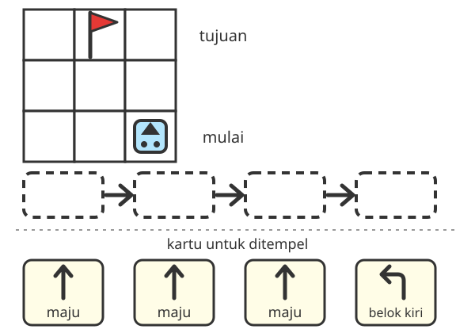

# Peta kisi 3x3

`[Gambar: peta tiga kali tiga petak dilihat dari atas. Boneka kecil berdiri di petak pojok kanan bawah menghadap ke atas, ditandai "mulai". Bendera merah ada di petak tengah baris paling atas, ditandai "tujuan". Di bawah peta ada empat kotak kosong bergaris putus-putus, dihubungkan tanda panah.]`

`[Gambar: di bagian bawah ada empat kartu untuk digunting: tiga kartu "maju" dengan panah lurus ke atas dan satu kartu "belok kiri" dengan panah melengkung ke kiri.]`

**Kata guru:** "Boneka mulai di sini, tujuannya bendera. Satu maju, satu petak. Susun kartunya di empat kotak, lalu ceritakan perintahnya."

**Kotak jawab:** tempel empat kartu di empat kotak, kartu pertama di kotak pertama.

**Ceritakan:** `[Gambar: satu kotak kosong di bawah, dengan gambar kecil mulut yang sedang berbicara.]`

**Kata guru:** "Kasih tahu temanmu: boneka maju berapa petak? Lalu apa perintah sesudahnya?"

**Catatan cetak (untuk guru, tidak dicetak):** satu lembar per kelompok kecil, kertas A4; siapkan satu set kartu per lembar. Jawaban contoh untuk guru: maju, maju, belok kiri, maju. Tanpa kolom nama, tanggal, atau penilaian.
