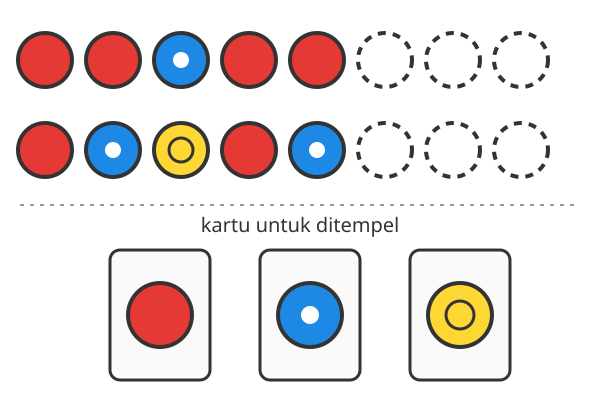

`[Gambar: baris pertama lima lingkaran: merah, merah, biru, merah, merah, lalu tiga lingkaran kosong bergaris putus-putus. Baris kedua lima lingkaran: merah, biru, kuning, merah, biru, lalu tiga lingkaran kosong bergaris putus-putus. Lingkaran biru punya titik putih di tengah dan lingkaran kuning punya cincin, supaya dapat dibedakan tanpa warna.]`

`[Gambar: di bagian bawah ada tiga kartu untuk digunting: merah polos, biru bertitik, dan kuning bercincin. Gunting beberapa salinan agar cukup untuk enam lingkaran kosong.]`

**Kata guru:** "Lihat barisnya dari kiri. Apa yang berikutnya? Tempel kartunya di lingkaran kosong, baris pertama dulu, lalu baris kedua."

**Kotak jawab:** tempel kartu di tiga lingkaran kosong pada tiap baris.

**Ceritakan:** `[Gambar: satu kotak kosong di bawah, dengan gambar kecil mulut yang sedang berbicara.]`

**Kata guru:** "Ceritakan ke temanmu: sesudah merah, merah, warna apa? Sesudah merah, biru, warna apa?"

**Catatan cetak (untuk guru, tidak dicetak):** satu lembar per kelompok kecil, kertas A4; siapkan enam kartu merah, tiga biru, dan tiga kuning per lembar. Tanpa kolom nama, tanggal, atau penilaian.
