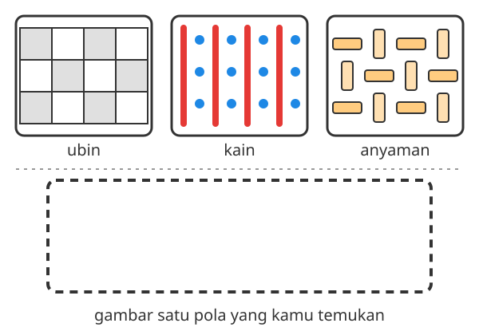

# Pola di sekitar kita

`[Gambar: tiga gambar pola berjajar di bagian atas. Pertama "ubin": kotak abu-abu dan putih berselang-seling. Kedua "kain": garis merah dan titik-titik biru bergantian. Ketiga "anyaman": batang mendatar dan batang tegak bergantian.]`

`[Gambar: di bagian bawah ada satu kotak besar kosong bergaris putus-putus, dengan tulisan "gambar satu pola yang kamu temukan".]`

**Kata guru:** "Lihat tiga gambar ini. Apa yang berulang di tiap gambar? Tunjuk polanya. Lalu gambar satu pola yang kamu temukan tadi di kotak."

**Kotak jawab:** gambar satu pola di kotak besar.

**Ceritakan:** `[Gambar: satu kotak kosong di bawah, dengan gambar kecil mulut yang sedang berbicara.]`

**Kata guru:** "Ceritakan ke temanmu: di mana kamu menemukan pola ini? Apa yang berulang?"

**Catatan cetak (untuk guru, tidak dicetak):** satu lembar per anak, kertas A4; krayon tidak beracun. Tanpa kolom nama, tanggal, atau penilaian.
