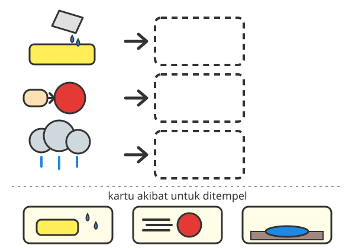

# Sebab dan akibat

`[Gambar: tiga baris. Baris pertama: cangkir miring menuang air ke spons kuning. Baris kedua: tangan mendorong bola. Baris ketiga: awan dengan tetes hujan. Di kanan tiap baris ada kotak kosong bergaris putus-putus, dihubungkan tanda panah.]`

`[Gambar: di bagian bawah ada tiga kartu akibat untuk digunting: spons dengan tetes air, bola dengan garis gerak, dan tanah dengan genangan kecil.]`

**Kata guru:** "Ini kejadian di sebelah kiri. Apa akibatnya? Tempel kartu akibat di kotak sebelahnya. Katakan, jika ini terjadi, maka itu terjadi."

**Kotak jawab:** tempel tiga kartu akibat di tiga kotak, tiap kartu di sebelah sebabnya.

**Ceritakan:** `[Gambar: satu kotak kosong di bawah, dengan gambar kecil mulut yang sedang berbicara.]`

**Kata guru:** "Kasih tahu temanmu: jika air dituang ke spons, apa yang terjadi?"

**Catatan cetak (untuk guru, tidak dicetak):** satu lembar per kelompok kecil, kertas A4; siapkan satu set tiga kartu akibat per lembar. Jawaban contoh untuk guru: air dituang dan spons basah; bola didorong dan bola menggelinding; hujan turun dan tanah basah. Tanpa kolom nama, tanggal, atau penilaian.
