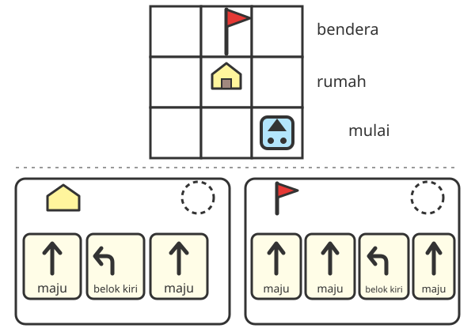

`[Gambar: peta tiga kali tiga petak dilihat dari atas. Boneka kecil berdiri di petak pojok kanan bawah menghadap ke atas, ditandai bintang. Rumah kecil ada di petak tengah. Bendera merah ada di petak tengah baris paling atas.]`

`[Gambar: di bawah peta ada dua kotak bergaris. Kotak kiri bergambar rumah dan tiga kartu: maju, belok kiri, maju. Kotak kanan bergambar bendera dan empat kartu: maju, maju, belok kiri, maju. Di tiap kotak ada lingkaran putus-putus kecil untuk menandai pilihan.]`

**Kata guru:** "Boneka mulai dari bintang. Ada dua jalan. Pilih satu jalan. Lingkari jalan pilihanmu."

**Kotak jawab:** lingkari satu dari dua jalan.

**Ceritakan:** `[Gambar: satu kotak kosong di bawah, dengan gambar kecil mulut yang sedang berbicara.]`

**Kata guru:** "Kasih tahu temanmu: kamu memilih jalan yang mana? Kamu memilihnya karena apa?"

**Catatan cetak (untuk guru, tidak dicetak):** satu lembar per kelompok kecil, kertas A4. Semua alasan diterima; tidak ada pilihan yang dinilai. Tanpa kolom nama, tanggal, atau penilaian.
