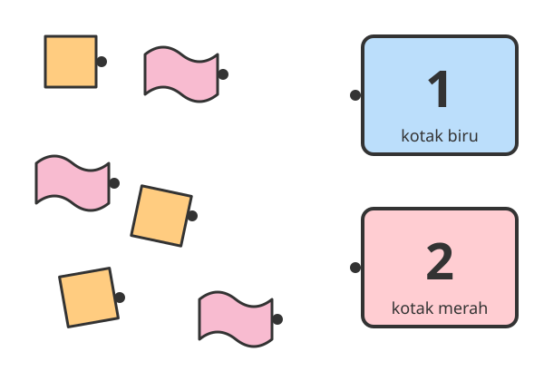

# Bagi-bagi tugas

`[Gambar: di kiri ada tiga balok persegi dan tiga kain bergelombang berserakan. Di kanan ada dua kotak: kotak biru diberi angka 1 dan kotak merah diberi angka 2. Di samping tiap benda ada titik kecil untuk menarik garis.]`

**Kata guru:** "Mainannya berantakan. Tugas besar kita, merapikan. Kita bagi dua bagian. Bagian satu, balok ke kotak biru. Bagian dua, kain ke kotak merah."

**Kotak jawab:** tarik garis dari tiap balok ke kotak biru, lalu dari tiap kain ke kotak merah.

**Ceritakan:** `[Gambar: satu kotak kosong di bawah, dengan gambar kecil mulut yang sedang berbicara.]`

**Kata guru:** "Kasih tahu temanmu: bagianmu yang mana, biru atau merah? Bagian mana yang lebih dulu? Kamu membantu temanmu di bagian apa?"

**Catatan cetak (untuk guru, tidak dicetak):** satu lembar per kelompok kecil, kertas A4; krayon biru dan merah. Jawaban contoh untuk guru: balok ke kotak biru, kain ke kotak merah. Tanpa kolom nama, tanggal, atau penilaian.
