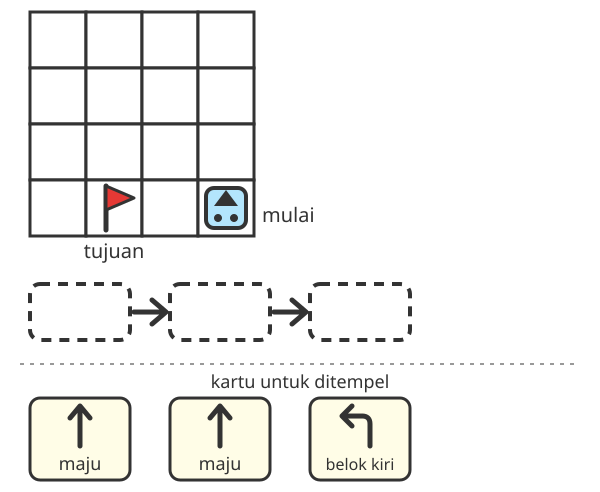

`[Gambar: kisi empat kali empat petak dilihat dari atas. Robot kecil berdiri di petak pojok kanan bawah menghadap ke atas, ditandai "mulai". Bendera merah ada di petak kedua dari kiri pada baris paling bawah, ditandai "tujuan". Di bawah kisi ada tiga kotak kosong bergaris putus-putus, dihubungkan tanda panah.]`

`[Gambar: di bagian bawah ada tiga kartu untuk digunting: dua kartu "maju" dengan panah lurus ke atas dan satu kartu "belok kiri" dengan panah melengkung ke kiri.]`

**Kata guru:** "Robot mulai di sini, tujuannya bendera. Susun tiga kartu di tiga kotak supaya robot sampai di bendera."

**Kotak jawab:** tempel tiga kartu di tiga kotak, kartu pertama di kotak pertama.

**Ceritakan:** `[Gambar: satu kotak kosong di bawah, dengan gambar kecil mulut yang sedang berbicara.]`

**Kata guru:** "Kasih tahu temanmu: kartu mana yang dikerjakan robot lebih dulu? Apa yang dilakukan robot sesudahnya?"

**Catatan cetak (untuk guru, tidak dicetak):** satu lembar per kelompok kecil, kertas A4; siapkan satu set tiga kartu per lembar. Jawaban contoh untuk guru: belok kiri, maju, maju. Tanpa kolom nama, tanggal, atau penilaian.
