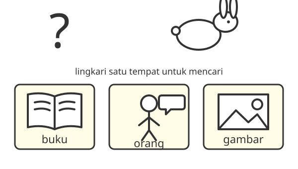

`[Gambar: di bagian atas ada tanda tanya besar dan gambar kelinci sederhana. Di bawahnya ada tiga kotak berjajar. Kotak kiri berisi buku terbuka dan tulisan "buku". Kotak tengah berisi sosok orang tanpa wajah dengan gelembung bicara dan tulisan "orang". Kotak kanan berisi bingkai gambar bergambar gunung dan matahari dan tulisan "gambar".]`

**Kata guru:** "Kita ingin tahu: kelinci makan apa? Kita bisa mencari di buku, di orang, atau di gambar. Lingkari satu tempat yang ingin kamu coba dulu."

**Kotak jawab:** lingkari satu dari tiga kotak.

**Ceritakan:** `[Gambar: satu kotak kosong di bawah, dengan gambar kecil mulut yang sedang berbicara.]`

**Kata guru:** "Kasih tahu temanmu: kamu mencari di mana? Selain itu, di mana lagi kita bisa mencari?"

**Catatan cetak (untuk guru, tidak dicetak):** satu lembar per anak atau pasangan, kertas A4. Jawaban contoh untuk guru: ketiga tempat boleh dipilih; tidak ada satu jawaban saja. Tanpa kolom nama, tanggal, atau penilaian.
