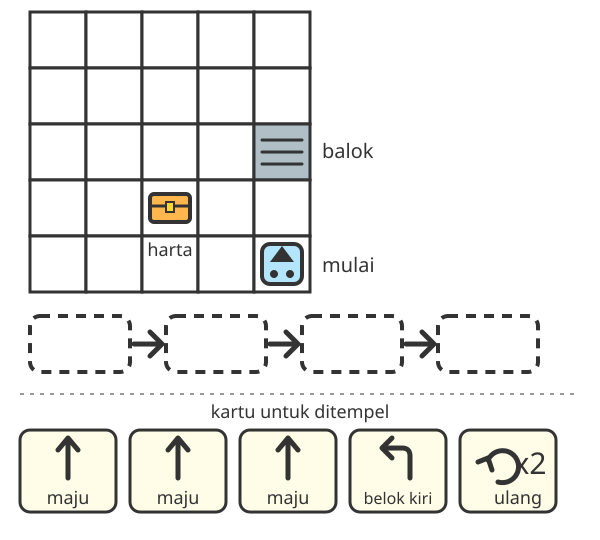

`[Gambar: kisi lima kali lima petak dilihat dari atas. Robot kecil berdiri di petak pojok kanan bawah menghadap ke atas, ditandai "mulai". Satu balok abu-abu menutup petak di tengah pada kolom paling kanan, ditandai "balok". Peti harta ada di petak ketiga dari kiri pada baris kedua dari bawah, ditandai "harta".]`

`[Gambar: di bawah kisi ada empat kotak kosong bergaris putus-putus yang dihubungkan tanda panah. Di bawahnya ada lima kartu untuk digunting: tiga kartu "maju" dengan panah lurus ke atas, satu kartu "belok kiri" dengan panah melengkung ke kiri, dan satu kartu "ulang x2" dengan tanda dua putaran.]`

**Kata guru:** "Robot harus sampai di harta. Robot tidak bisa lewat balok. Pilih empat kartu dan susun di empat kotak. Jalankan dengan jarimu."

**Kotak jawab:** tempel empat kartu di empat kotak, kartu pertama di kotak pertama.

**Ceritakan:** `[Gambar: satu kotak kosong di bawah, dengan gambar kecil mulut yang sedang berbicara.]`

**Kata guru:** "Kasih tahu temanmu: kartu mana yang pertama dan mana yang terakhir? Kalau robot berhenti di balok, kartu mana yang kamu ubah?"

**Catatan cetak (untuk guru, tidak dicetak):** satu lembar per anak atau pasangan, kertas A4; siapkan satu set lima kartu per lembar, satu kartu sisa tidak dipakai. Jawaban contoh untuk guru: maju, belok kiri, ulang x2, maju (atau maju, belok kiri, maju, maju). Tanpa kolom nama, tanggal, atau penilaian.
