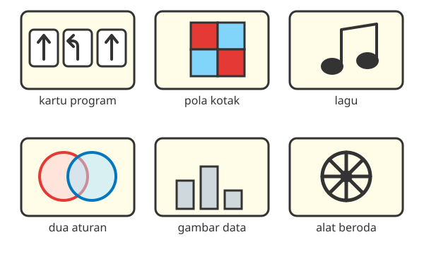

`[Gambar: enam kotak gambar dalam dua baris. Baris atas dari kiri ke kanan: tiga kartu panah berurutan bertuliskan "kartu program"; empat kotak kecil merah dan biru berselang-seling bertuliskan "pola kotak"; gambar not musik bertuliskan "lagu". Baris bawah dari kiri ke kanan: dua lingkaran berpotongan bertuliskan "dua aturan"; tiga kolom bertuliskan "gambar data"; sebuah roda bertuliskan "alat beroda".]`

**Kata guru:** "Ini permainan yang kita lakukan semester ini. Lingkari satu permainan yang paling kamu suka."

**Kotak jawab:** lingkari satu dari enam gambar. Tiap anak boleh memilih yang berbeda.

**Ceritakan:** `[Gambar: satu kotak kosong di bawah, dengan gambar kecil mulut yang sedang berbicara.]`

**Kata guru:** "Kasih tahu temanmu: permainan apa yang kamu pilih? Apa yang pertama kamu lakukan, dan apa yang terakhir? Mengapa kamu suka?"

**Catatan cetak (untuk guru, tidak dicetak):** satu lembar per anak atau pasangan, kertas A4. Jawaban contoh untuk guru: semua pilihan diterima, tidak ada satu jawaban saja. Tanpa kolom nama, tanggal, atau penilaian.
