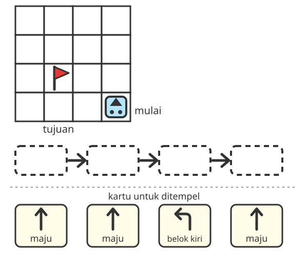

`[Gambar: kisi empat kali empat petak dilihat dari atas. Robot kecil berdiri di petak pojok kanan bawah menghadap ke atas, ditandai "mulai". Bendera merah ada di petak kedua dari kiri pada baris ketiga dari atas, ditandai "tujuan". Di bawah kisi ada empat kotak kosong bergaris putus-putus, dihubungkan tanda panah.]`

`[Gambar: di bagian bawah ada empat kartu untuk digunting: tiga kartu "maju" dengan panah lurus ke atas dan satu kartu "belok kiri" dengan panah melengkung ke kiri.]`

**Kata guru:** "Susun empat kartu untuk temanmu. Robot mulai di sini, tujuannya bendera. Teman menjalankan sebagai robot."

**Kotak jawab:** tempel empat kartu di empat kotak, kartu pertama di kotak pertama.

**Ceritakan:** `[Gambar: satu kotak kosong di bawah, dengan gambar kecil mulut yang sedang berbicara.]`

**Kata guru:** "Kasih tahu temanmu: kartu mana yang pertama, dan kartu mana yang terakhir?"

**Catatan cetak (untuk guru, tidak dicetak):** satu lembar per pasangan atau kelompok kecil, kertas A4; siapkan satu set empat kartu per lembar. Jawaban contoh untuk guru: maju, belok kiri, maju, maju. Tanpa kolom nama, tanggal, atau penilaian.
