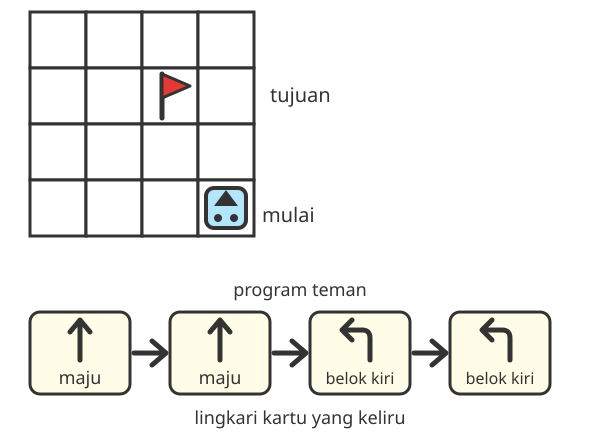

`[Gambar: kisi empat kali empat petak dilihat dari atas. Robot kecil berdiri di petak pojok kanan bawah menghadap ke atas, ditandai "mulai". Bendera merah ada di petak ketiga dari kiri pada baris kedua dari atas, ditandai "tujuan".]`

`[Gambar: di bawah kisi ada empat kartu yang sudah tersusun dari kiri ke kanan dan dihubungkan tanda panah: "maju", "maju", "belok kiri", "belok kiri". Di bawahnya tertulis kecil "lingkari kartu yang keliru".]`

**Kata guru:** "Program temanmu belum sampai di bendera. Ada satu kartu yang keliru. Jalankan dengan jarimu, lalu lingkari kartu yang keliru."

**Kotak jawab:** lingkari satu kartu yang keliru.

**Ceritakan:** `[Gambar: satu kotak kosong di bawah, dengan gambar kecil mulut yang sedang berbicara.]`

**Kata guru:** "Kasih tahu temanmu: kartu apa yang kamu pasang sebagai pengganti, dan mengapa?"

**Catatan cetak (untuk guru, tidak dicetak):** satu lembar per anak atau pasangan, kertas A4. Jawaban contoh untuk guru: kartu keempat keliru; gantikan dengan "maju" agar susunan menjadi maju, maju, belok kiri, maju. Tanpa kolom nama, tanggal, atau penilaian.
