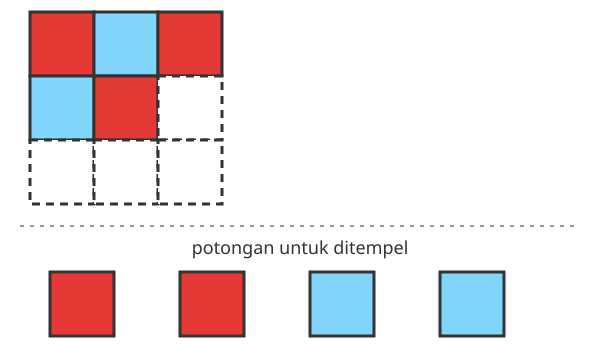

`[Gambar: kotak tiga kali tiga. Baris pertama: merah, biru, merah. Baris kedua: biru, merah, lalu satu kotak kosong bergaris putus-putus. Baris ketiga: tiga kotak kosong bergaris putus-putus. Warna berganti-ganti ke samping dan ke bawah.]`

`[Gambar: di bagian bawah ada empat potongan persegi untuk digunting: dua potongan merah dan dua potongan biru.]`

**Kata guru:** "Lanjutkan pola kotak ini. Warna berganti-ganti ke samping dan ke bawah. Tempel potongan di kotak yang kosong."

**Kotak jawab:** tempel empat potongan warna di empat kotak kosong.

**Ceritakan:** `[Gambar: satu kotak kosong di bawah, dengan gambar kecil mulut yang sedang berbicara.]`

**Kata guru:** "Kasih tahu temanmu: apa aturan pola ini? Apa yang berikutnya sesudah merah?"

**Catatan cetak (untuk guru, tidak dicetak):** satu lembar per anak atau pasangan, kertas A4; siapkan empat potongan (dua merah, dua biru) per lembar. Jawaban contoh untuk guru: baris kedua biru, merah, biru; baris ketiga merah, biru, merah. Tanpa kolom nama, tanggal, atau penilaian.
