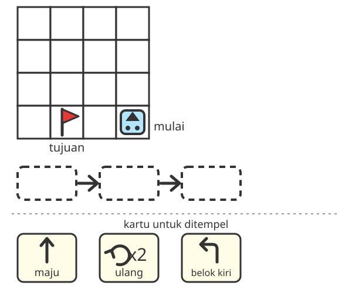

`[Gambar: kisi empat kali empat petak dilihat dari atas. Robot kecil berdiri di petak pojok kanan bawah menghadap ke atas, ditandai "mulai". Bendera merah ada di petak kedua dari kiri pada baris paling bawah, ditandai "tujuan". Di bawah kisi ada tiga kotak kosong bergaris putus-putus, dihubungkan tanda panah.]`

`[Gambar: di bagian bawah ada tiga kartu untuk digunting: satu kartu "maju" dengan panah lurus ke atas, satu kartu "ulang x2" dengan tanda dua putaran, dan satu kartu "belok kiri" dengan panah melengkung ke kiri.]`

**Kata guru:** "Robot harus sampai di bendera. Kartu ulang x2 menyuruh robot mengerjakan satu kartu dua kali. Susun tiga kartu di tiga kotak."

**Kotak jawab:** tempel tiga kartu di tiga kotak, kartu pertama di kotak pertama.

**Ceritakan:** `[Gambar: satu kotak kosong di bawah, dengan gambar kecil mulut yang sedang berbicara.]`

**Kata guru:** "Kasih tahu temanmu: kartu ulang x2 menyuruh robot melakukan apa? Berapa kali robot maju?"

**Catatan cetak (untuk guru, tidak dicetak):** satu lembar per anak atau pasangan, kertas A4; siapkan satu set tiga kartu per lembar. Jawaban contoh untuk guru: belok kiri, ulang x2, maju. Tanpa kolom nama, tanggal, atau penilaian.
