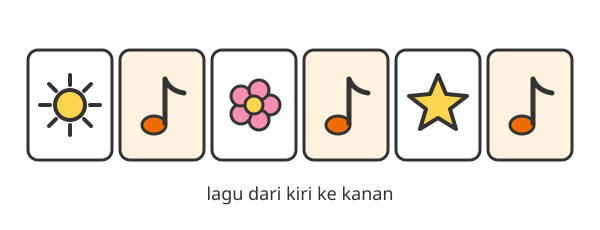

`[Gambar: satu baris enam kotak gambar berurutan dari kiri ke kanan. Kotak pertama bergambar matahari, kotak kedua not lagu berwarna jingga, kotak ketiga bunga, kotak keempat not lagu yang sama, kotak kelima bintang, kotak keenam not lagu yang sama.]`

**Kata guru:** "Ini bagian-bagian lagu kita. Lingkari gambar yang muncul lagi dan lagi. Lalu tepuk tangan setiap kali bagian itu datang."

**Kotak jawab:** lingkari gambar yang muncul berulang.

**Ceritakan:** `[Gambar: satu kotak kosong di bawah, dengan gambar kecil mulut yang sedang berbicara.]`

**Kata guru:** "Kasih tahu temanmu: bagian mana yang muncul lagi dan lagi? Gerak apa yang kamu pilih untuk bagian itu?"

**Catatan cetak (untuk guru, tidak dicetak):** satu lembar per anak atau pasangan, kertas A4. Jawaban contoh untuk guru: tiga gambar not lagu. Tanpa kolom nama, tanggal, atau penilaian.
