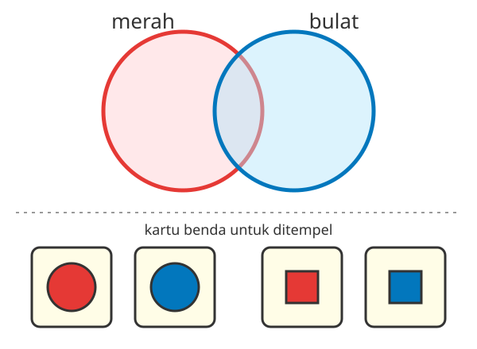

`[Gambar: dua lingkaran besar saling berpotongan dilihat dari atas. Lingkaran kiri diberi tulisan "merah" dan bergaris merah. Lingkaran kanan diberi tulisan "bulat" dan bergaris biru. Daerah tengah, tempat dua lingkaran bertemu, kosong.]`

`[Gambar: di bawah ada empat kartu benda untuk digunting: satu bulatan merah, satu bulatan biru, satu persegi merah, dan satu persegi biru.]`

**Kata guru:** "Ada dua aturan: merah dan bulat. Tempelkan tiap kartu di tempat yang cocok. Kartu yang cocok dengan dua aturan ditaruh di tengah."

**Kotak jawab:** tempel empat kartu di lingkaran, di tengah, atau di luar lingkaran.

**Ceritakan:** `[Gambar: satu kotak kosong di bawah, dengan gambar kecil mulut yang sedang berbicara.]`

**Kata guru:** "Kasih tahu temanmu: kartu mana yang kamu taruh di tengah? Apa yang sama dari kartu itu dengan dua aturan?"

**Catatan cetak (untuk guru, tidak dicetak):** satu lembar per anak atau pasangan, kertas A4; siapkan satu set empat kartu per lembar. Jawaban contoh untuk guru: bulatan merah di tengah; bulatan biru di lingkaran "bulat" saja; persegi merah di lingkaran "merah" saja; persegi biru di luar. Tanpa kolom nama, tanggal, atau penilaian.
