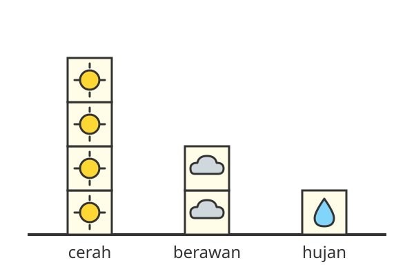

`[Gambar: tiga kolom tegak berdiri di atas satu garis. Kolom kiri diberi tulisan "cerah" dan berisi empat gambar matahari bertumpuk. Kolom tengah diberi tulisan "berawan" dan berisi dua gambar awan bertumpuk. Kolom kanan diberi tulisan "hujan" dan berisi satu gambar tetes air.]`

**Kata guru:** "Ini gambar cuaca dari kelas lain. Satu gambar mewakili satu stiker. Lihat tinggi tiap kolom. Lingkari kolom yang paling banyak."

**Kotak jawab:** lingkari satu kolom, yaitu kolom yang paling banyak.

**Ceritakan:** `[Gambar: satu kotak kosong di bawah, dengan gambar kecil mulut yang sedang berbicara.]`

**Kata guru:** "Kasih tahu temanmu: kolom mana yang paling banyak, dan kolom mana yang paling sedikit? Mana yang lebih banyak, cerah atau hujan?"

**Catatan cetak (untuk guru, tidak dicetak):** satu lembar per anak atau pasangan, kertas A4. Jawaban contoh untuk guru: kolom "cerah" paling banyak (empat), kolom "hujan" paling sedikit (satu); cerah lebih banyak dari hujan. Tanpa kolom nama, tanggal, atau penilaian.
