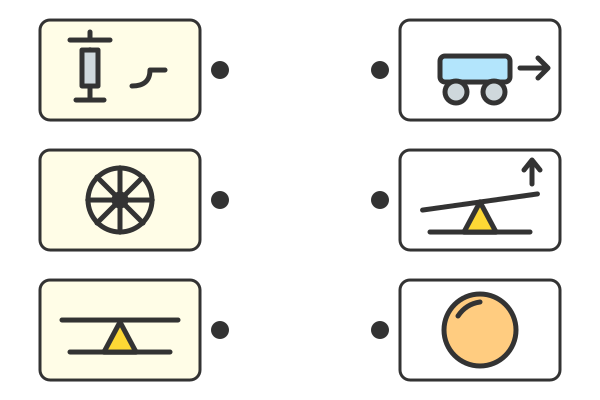

`[Gambar: dua kolom gambar dengan titik di tepinya. Kolom kiri, dari atas ke bawah: pompa, roda, dan tuas (papan di atas segitiga kecil). Kolom kanan, dari atas ke bawah: kereta kecil beroda yang bergerak ke kanan, papan yang satu ujungnya terangkat dengan panah ke atas, dan bola besar yang penuh.]`

**Kata guru:** "Tiap alat membuat sesuatu terjadi. Tarik garis dari alat ke gambar yang terjadi karena alat itu."

**Kotak jawab:** tarik tiga garis dari titik alat ke titik gambar yang cocok.

**Ceritakan:** `[Gambar: satu kotak kosong di bawah, dengan gambar kecil mulut yang sedang berbicara.]`

**Kata guru:** "Kasih tahu temanmu: pompa, roda, dan tuas, masing-masing bekerja bagaimana? Aturan aman apa yang kita pakai?"

**Catatan cetak (untuk guru, tidak dicetak):** satu lembar per anak atau pasangan, kertas A4; krayon untuk menarik garis. Jawaban contoh untuk guru: pompa ke bola yang penuh; roda ke kereta yang menggelinding; tuas ke ujung papan yang terangkat. Tanpa kolom nama, tanggal, atau penilaian.
