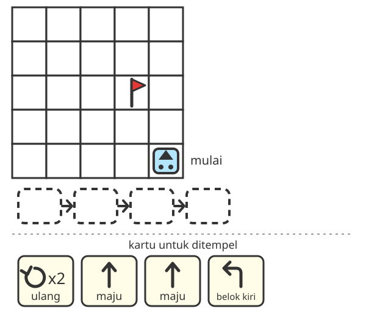

`[Gambar: kisi lima kali lima petak dilihat dari atas. Robot kecil berdiri di petak pojok kanan bawah menghadap ke atas, ditandai "mulai". Bendera merah ada di petak keempat dari kiri pada baris ketiga dari atas. Di bawah kisi ada empat kotak kosong bergaris putus-putus, dihubungkan tanda panah.]`

`[Gambar: di bagian bawah ada empat kartu untuk digunting: satu kartu "ulang x2" dengan tanda putaran, dua kartu "maju" dengan panah lurus ke atas, dan satu kartu "belok kiri" dengan panah melengkung ke kiri.]`

**Kata guru:** "Robot harus sampai di bendera. Susun empat kartu di empat kotak. Kartu ulang x2 menyuruh kita mengerjakan satu kartu dua kali."

**Kotak jawab:** tempel empat kartu di empat kotak, kartu pertama di kotak pertama.

**Ceritakan:** `[Gambar: satu kotak kosong di bawah, dengan gambar kecil mulut yang sedang berbicara.]`

**Kata guru:** "Kasih tahu temanmu langkah robot dari awal sampai akhir: kartu mana yang pertama, dan kartu mana yang terakhir?"

**Catatan cetak (untuk guru, tidak dicetak):** satu lembar per anak atau pasangan, kertas A4; siapkan satu set empat kartu per lembar. Jawaban contoh untuk guru: ulang x2, maju, belok kiri, maju (kartu maju kedua dipakai di kotak keempat). Tanpa kolom nama, tanggal, atau penilaian.
