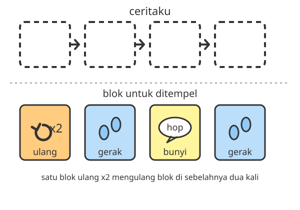

`[Gambar: di atas ada empat kotak kosong bergaris putus-putus berderet dari kiri ke kanan, dihubungkan tanda panah, berjudul "ceritaku". Di bawah ada empat blok untuk digunting: blok oranye "ulang x2" dengan panah putaran, blok biru "gerak" dengan dua jejak kaki, blok kuning "bunyi" dengan balon bicara "hop", dan satu blok biru "gerak" lagi.]`

**Kata guru:** "Susun empat blok di empat kotak untuk membuat cerita kelinci: melompat dua kali, lalu berbunyi hop, lalu melompat sekali lagi. Blok ulang x2 menyuruh blok di sebelahnya dikerjakan dua kali."

**Kotak jawab:** tempel empat blok di empat kotak, blok pertama di kotak pertama.

**Ceritakan:** `[Gambar: satu kotak kosong di bawah, dengan gambar kecil mulut yang sedang berbicara.]`

**Kata guru:** "Kasih tahu temanmu ceritanya dari blok pertama sampai blok terakhir. Apa yang dikerjakan dua kali?"

**Catatan cetak (untuk guru, tidak dicetak):** satu lembar per anak atau pasangan, kertas A4; siapkan satu set empat blok per lembar. Jawaban contoh untuk guru: ulang x2, gerak, bunyi, gerak (cerita: melompat, melompat, hop, melompat). Tanpa kolom nama, tanggal, atau penilaian.
