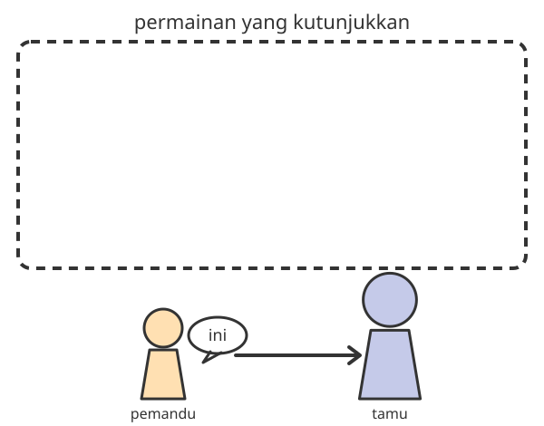

`[Gambar: di atas ada satu kotak besar bergaris putus-putus berjudul "permainan yang kutunjukkan". Di bawahnya ada dua tokoh polos tanpa wajah: tokoh kecil berwarna jingga muda berlabel "pemandu" dengan balon bicara, dan tokoh besar berwarna ungu muda berlabel "tamu". Satu tanda panah menghubungkan balon bicara ke tamu.]`

**Kata guru:** "Gambar permainan yang akan kamu tunjukkan kepada tamu. Kamu jadi pemandu."

**Kotak jawab:** gambar permainan pilihanmu di kotak besar.

**Ceritakan:** `[Gambar: satu kotak kosong di bawah, dengan gambar kecil mulut yang sedang berbicara.]`

**Kata guru:** "Kasih tahu tamumu: ini permainan apa? Apa yang pertama kamu jelaskan, dan apa yang terakhir?"

**Catatan cetak (untuk guru, tidak dicetak):** satu lembar per anak, kertas A4; siapkan krayon. Jawaban contoh untuk guru: semua pilihan diterima, tidak ada satu jawaban saja. Tanpa kolom nama, tanggal, atau penilaian.
