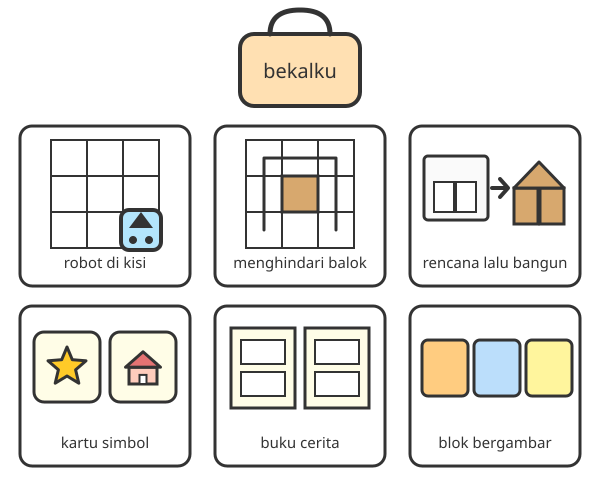

`[Gambar: di atas ada gambar sebuah tas berwarna jingga muda bertuliskan "bekalku". Di bawahnya ada enam kotak gambar dalam dua baris. Baris atas dari kiri ke kanan: kisi tiga kali tiga dengan robot di petak pojok kanan bawah ("robot di kisi"); kisi tiga kali tiga dengan satu petak balok cokelat dan garis jalan yang mengitarinya ("menghindari balok"); gambar rencana kertas berpanah ke bangunan balok ("rencana lalu bangun"). Baris bawah dari kiri ke kanan: dua kartu, bintang dan rumah ("kartu simbol"); dua halaman buku terbuka dengan kotak gambar ("buku cerita"); tiga blok warna oranye, biru, dan kuning ("blok bergambar").]`

**Kata guru:** "Ini tas bekalku. Lingkari satu hal baru yang sekarang kamu bisa. Itu bekalmu."

**Kotak jawab:** lingkari satu dari enam gambar. Tiap anak boleh memilih yang berbeda.

**Ceritakan:** `[Gambar: satu kotak kosong di bawah, dengan gambar kecil mulut yang sedang berbicara.]`

**Kata guru:** "Kasih tahu temanmu: dulu kamu belum bisa apa? Sekarang kamu bisa apa?"

**Catatan cetak (untuk guru, tidak dicetak):** satu lembar per anak, kertas A4. Jawaban contoh untuk guru: semua pilihan diterima, tidak ada satu jawaban saja. Tanpa kolom nama, tanggal, atau penilaian.
