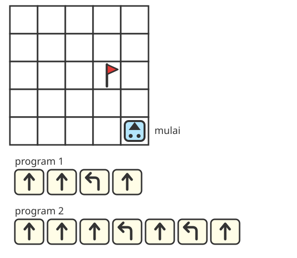

`[Gambar: kisi lima kali lima petak dilihat dari atas. Robot kecil berdiri di petak pojok kanan bawah menghadap ke atas, ditandai "mulai". Bendera merah ada di petak keempat dari kiri pada baris ketiga dari atas.]`

`[Gambar: di bawah kisi ada dua baris kartu. Baris "program 1" punya empat kartu kecil: maju, maju, belok kiri, maju. Baris "program 2" punya tujuh kartu kecil: maju, maju, maju, belok kiri, maju, belok kiri, maju.]`

**Kata guru:** "Dua program ini sama-sama sampai di bendera. Hitung kartu di tiap baris dengan jarimu. Lingkari program yang kartunya lebih sedikit."

**Kotak jawab:** lingkari satu program, yang kartunya lebih sedikit.

**Ceritakan:** `[Gambar: satu kotak kosong di bawah, dengan gambar kecil mulut yang sedang berbicara.]`

**Kata guru:** "Kasih tahu temanmu: kamu memilih program yang mana, dan mengapa?"

**Catatan cetak (untuk guru, tidak dicetak):** satu lembar per anak atau pasangan, kertas A4. Jawaban contoh untuk guru: program 1 (empat kartu) lebih sedikit dari program 2 (tujuh kartu). Tanpa kolom nama, tanggal, atau penilaian.
